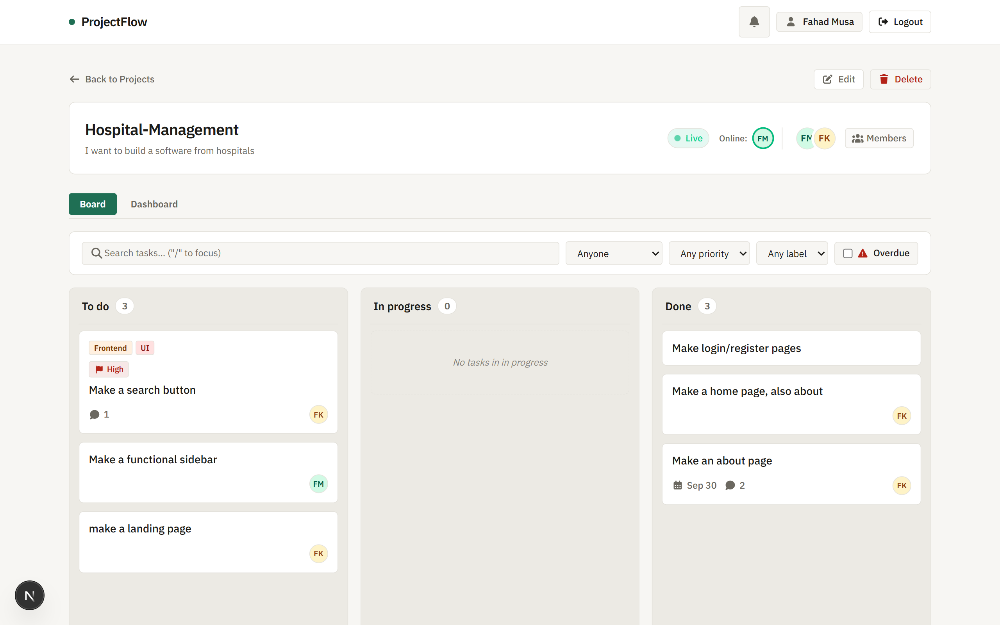
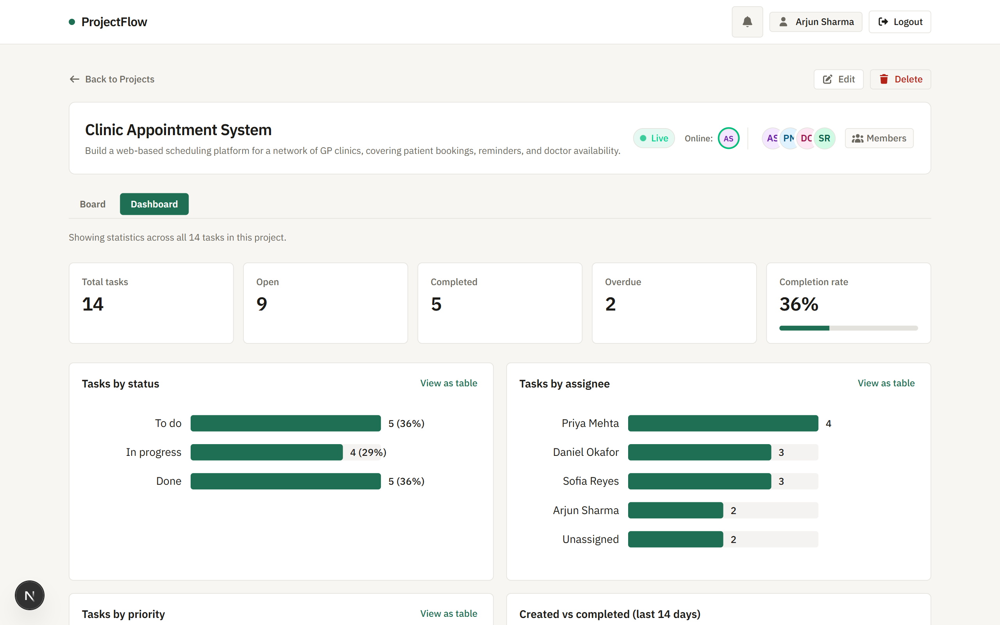
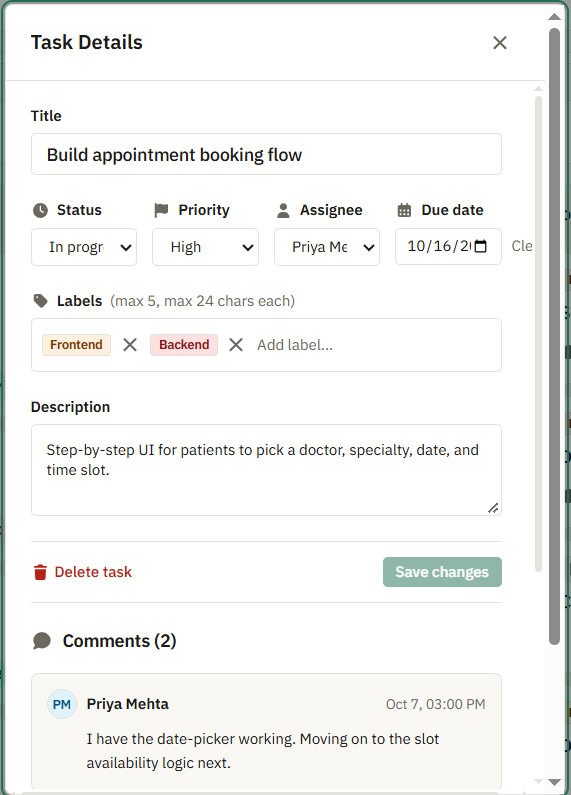
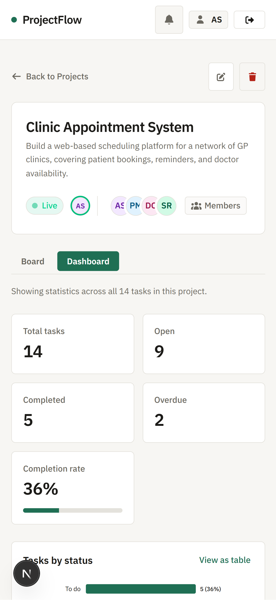

# ProjectFlow

A collaborative project and task management application with real-time updates and kanban boards.


**Live demo:** https://code-alpha-project-flow.vercel.app

## Overview

ProjectFlow is a project management tool designed for teams to organize tasks, track progress across custom kanban columns, and collaborate in real time. It provides visual task boards with drag and drop, inline comments, member role management, in-app notifications, and a project dashboard with delivery metrics.

Built as Task 3 (Project Management Tool) of the CodeAlpha Full Stack Development internship.

## Demo accounts

The database seed script populates 5 demo accounts. All accounts share the same password: `projectflow-demo-1234`.

| Name | Email | Project roles |
| --- | --- | --- |
| Arjun Sharma | arjun.sharma@projectflow.demo | Owner of Clinic Appointment System |
| Priya Mehta | priya.mehta@projectflow.demo | Owner of Brand Refresh; Member of Clinic Appointment System |
| Daniel Okafor | daniel.okafor@projectflow.demo | Owner of Office Move Q1; Member of Clinic Appointment System |
| Sofia Reyes | sofia.reyes@projectflow.demo | Member of Clinic Appointment System and Brand Refresh |
| Lena Fischer | lena.fischer@projectflow.demo | Member of Brand Refresh and Office Move Q1 |

To generate these accounts and sample data:
```bash
npm run seed
```

*Note: These demo accounts exist in the database only after running the seed command.*

## Features

### Accounts and security
- User registration and login with email and password
- Passwords hashed using bcrypt (cost factor 10)
- Stateless authentication using JWT tokens stored in httpOnly, SameSite cookies
- Fixed-window rate limiting on login and registration backed by MongoDB
- Route protection and authentication redirects handled at the proxy layer

### Projects and roles
- Create, rename, and delete projects
- Role-based project permissions: Owner and Member
- Project owners can add members by email and remove members
- Deleting a project cascades deletion across tasks, comments, and notifications

### Board and tasks
- Kanban board with columns: Todo, In Progress, and Done
- Drag-and-drop task reordering and column transfers powered by `@dnd-kit`
- Fractional ordering for constant-time card repositioning with automatic column renumbering
- Task metadata: priority (low, medium, high), colored label tags, due dates, and assignee assignment
- Task detail modal with threaded discussions and comment submission
- Filtering tasks by assignee, priority, and text search query

### Realtime
- WebSocket synchronization powered by Ably
- Live board updates on card creation, moves, edits, and deletions
- Real-time online member presence indicators across active boards
- Event publishing from server routes following database writes

### Notifications
- In-app alerts for task assignment, comments, and project invitations
- Notification bell badge with unread count indicator
- Mark individual notifications as read or mark all as read
- Real-time notification delivery via dedicated user channels

### Dashboard
- Project statistics view with key delivery indicators: total tasks, completion percentage, overdue count, and active members
- Tasks by status distribution chart
- Overdue tasks breakdown by priority
- 7-day completion activity chart
- Workload distribution by team member
- Hand-written SVG charts without external charting libraries

### Interface
- Hand-designed layout using IBM Plex Sans typography and neutral palette
- Accessible semantic landmarks and WCAG AA contrast ratios
- Fully responsive layout supporting viewports down to 360px width
- Skip-to-content keyboard navigation link

## Screenshots

| View | Screenshot |
| --- | --- |
| **Kanban Board**<br>Live columns with drag-and-drop cards and active presence indicators. |  |
| **Project Dashboard**<br>Custom SVG charts showing completion trends, overdue tasks, and workload. |  |
| **Task Details**<br>Modal for task priority, labels, assignee, due date, and team discussion. |  |
| **Mobile Interface**<br>Responsive board interface adapted for phone screens. |  |

## Tech stack

### Frontend
- **Framework**: Next.js 16.4.0 (App Router)
- **Library**: React 19.3.0
- **Styling**: Tailwind CSS 4 with custom CSS variables
- **Drag and Drop**: `@dnd-kit/core` and `@dnd-kit/sortable`
- **Icons**: Font Awesome (`@fortawesome/react-fontawesome`)
- **Charts**: Custom SVG implementations rendered directly in React components without a third-party charting library

### Backend
- **Server Framework**: Next.js Route Handlers and Server Components
- **Language**: TypeScript 5
- **Authentication**: JWT verification with `jose` and `bcryptjs`
- **Validation**: Zod 4.6.5

### Database and services
- **Database**: MongoDB with Mongoose 9.11.0 ODM
- **Realtime Service**: Ably 2.29.0 for WebSocket pub/sub and presence

### Tooling
- **Linter**: ESLint 9 (`eslint-config-next`)
- **Type Checker**: TypeScript Compiler (`tsc`)
- **Script Runner**: `tsx` for running seed scripts with Node `--env-file`

## How it works

### Authentication
Authentication relies on JSON Web Tokens (JWT) signed with HMAC-SHA256. Upon successful login or registration, the token is written to an `httpOnly`, `SameSite=lax` cookie named `token`. In production, the cookie is marked `secure`. Every incoming request passes through `src/proxy.ts`, which extracts and verifies the token. If an unauthenticated user attempts to access a protected route, the proxy redirects them to `/login?from=<pathname>`. Logged-in users attempting to access `/`, `/login`, or `/register` are redirected to `/projects`.

### Authorization
All route handlers perform server-side verification before executing database queries. The system inspects project membership for every operation. If the requesting user is not a member of the project containing the target entity, the route responds with `404 Not Found` rather than `403 Forbidden` to prevent project enumeration. Administrative operations (renaming a project, adding members, removing members, or deleting a project) enforce the `owner` role check.

### Card ordering
Cards within a column maintain a floating-point `order` number. Moving a card calculates the midpoint between the previous and next card orders: `(orderAbove + orderBelow) / 2`. Placing a card at the top assigns `firstOrder - 1`, and placing at the bottom assigns `lastOrder + 1`. If the gap between two cards becomes smaller than `1e-6`, the frontend triggers a renumbering sequence that resets card orders in that column to consecutive integers (1, 2, 3...) to prevent precision underflow.

### Realtime
Real-time messaging uses Ably WebSockets. State changes are published from server route handlers only after the database write succeeds. Clients request short-lived (15 minutes) subscribe-only Ably token requests via `/api/ably/token`. Token capabilities restrict users strictly to subscribing to their accessible project channels (`project:<id>`) and their private notification channel (`user:<userId>`). Board channels include presence tracking so members can view who is viewing the board concurrently.

### Notifications
When a task is assigned, a comment is posted, or a user is added to a project, the server creates records in the `Notification` MongoDB collection and publishes a message to `user:<userId>` on Ably. The client `NotificationsProvider` listens on this channel to increment the unread count badge and append alerts in real time.

### Rate limiting
Because serverless functions run across isolated ephemeral instances without shared memory, rate limiting is backed by MongoDB via the `RateLimit` collection. Each check performs an atomic `findOneAndUpdate` with `upsert: true` on fixed time windows. If a window document exists and has not expired, its hit counter increments; otherwise, a new window document is created. A unique index on the key prevents race conditions, and a MongoDB TTL index on `expiresAt` automatically cleans up expired counters. If database access fails, the limiter fails open and logs the issue so legitimate users are not locked out.

### Input validation
All incoming request payloads are parsed and validated using Zod schemas in `src/lib/validators.ts`. Fields outside the schema are stripped, preventing unwanted property injection. Route handlers reject malformed payloads with descriptive 400 Bad Request responses before querying database models.

## Project structure

```text
projectflow/
├── public/
│   ├── screens/                # Real application screenshot assets
│   │   ├── board.png
│   │   ├── dashboard.png
│   │   ├── mobile.png
│   │   └── task.png
│   └── favicon.ico
├── scripts/
│   └── seed.ts                 # Database seeding and cleanup script
├── src/
│   ├── app/
│   │   ├── (app)/              # Authenticated app shell layout and routes
│   │   │   ├── layout.tsx
│   │   │   └── projects/       # Projects list and board pages
│   │   ├── (auth)/             # Authentication layout and login/register routes
│   │   │   ├── login/
│   │   │   └── register/
│   │   ├── api/                # API route handlers
│   │   │   ├── ably/token/     # Ephemeral Ably token generation
│   │   │   ├── auth/           # Login, register, logout, and me endpoints
│   │   │   ├── notifications/  # Notification retrieval and mark-read
│   │   │   ├── projects/       # Project CRUD and member management
│   │   │   └── tasks/          # Task update, delete, and comment endpoints
│   │   ├── globals.css         # Tailwind tokens and base styling
│   │   ├── layout.tsx          # Root HTML layout with font setup
│   │   └── page.tsx            # Public landing page
│   ├── components/
│   │   ├── dashboard/          # Custom SVG charts and metrics cards
│   │   ├── landing/            # Public landing page components
│   │   ├── ui/                 # Reusable UI primitives (Button, Dialog, etc.)
│   │   ├── AppHeader.tsx       # Application top navigation
│   │   ├── BoardColumn.tsx     # Kanban board column container
│   │   ├── FilterBar.tsx       # Search and filter toolbar
│   │   ├── MembersDialog.tsx   # Project member management dialog
│   │   ├── NotificationBell.tsx# Notification drop-down panel
│   │   ├── NotificationsProvider.tsx # In-app notification context
│   │   ├── ProjectBoardClient.tsx # Kanban drag-and-drop state manager
│   │   ├── ProjectHeader.tsx   # Project title bar and active presence
│   │   ├── ProjectModals.tsx   # Modals for new tasks and project settings
│   │   ├── RealtimeProvider.tsx# Ably client connection manager
│   │   ├── TaskCard.tsx        # Draggable task card item
│   │   └── TaskDialog.tsx      # Task details view and comment thread
│   ├── lib/
│   │   ├── access.ts           # Project membership check helpers
│   │   ├── api.ts              # Client-side fetch wrapper
│   │   ├── auth.ts             # Auth cookie helpers and token generation
│   │   ├── db.ts               # Cached Mongoose connection manager
│   │   ├── jwt.ts              # Jose JWT signing and verification
│   │   ├── notifications.ts    # Notification insertion and publishing
│   │   ├── rate-limit.ts       # MongoDB-backed fixed-window rate limiter
│   │   ├── realtime.ts         # Server-side Ably event publisher
│   │   ├── redirect.ts         # Navigation redirect helper
│   │   └── validators.ts       # Zod validation schemas
│   ├── models/
│   │   ├── Comment.ts          # Mongoose Comment model
│   │   ├── Notification.ts     # Mongoose Notification model
│   │   ├── Project.ts          # Mongoose Project model
│   │   ├── RateLimit.ts        # Mongoose RateLimit model with TTL index
│   │   ├── Task.ts             # Mongoose Task model
│   │   └── User.ts             # Mongoose User model
│   ├── proxy.ts                # Next.js proxy middleware for auth and routing
│   └── types/
│       └── index.ts            # Shared TypeScript type declarations
├── .env.example                # Template for environment variables
├── eslint.config.mjs           # ESLint configuration
├── next.config.ts              # Next.js configuration
├── package.json                # Project dependencies and scripts
└── tsconfig.json               # TypeScript configuration
```

## Getting started

### Prerequisites
- Node.js version `>=20.9.0`
- MongoDB database (local MongoDB instance or MongoDB Atlas cluster)
- Ably account and API key (optional; if omitted, the application operates normally with real-time sync disabled)

### Clone and install
```bash
git clone https://github.com/fahadmusa725/projectflow.git
cd projectflow
npm install
```

### Environment variables
Copy `.env.example` to create your local `.env` file:
```bash
cp .env.example .env
```

Configure the following variables in `.env`:

| Variable | Required | Description |
| --- | --- | --- |
| `MONGODB_URI` | Yes | MongoDB connection string (e.g. `mongodb://localhost:27017/projectflow`) |
| `JWT_SECRET` | Yes | Secret key used to sign and verify JSON Web Tokens |
| `ABLY_API_KEY` | Optional | Ably API key for real-time WebSockets and presence |

Generate a cryptographically secure value for `JWT_SECRET`:
```bash
node -e "console.log(require('crypto').randomBytes(32).toString('hex'))"
```

### Running the application
Start the development server:
```bash
npm run dev
```
Open [http://localhost:3000](http://localhost:3000) in your browser.

### Seeding demo data
Populate the database with demo users, projects, tasks, comments, and notifications:
```bash
npm run seed
```

To remove all demo data:
```bash
npm run seed:remove
```

### Code verification and production build
Check TypeScript types:
```bash
npx tsc --noEmit
```

Run linter:
```bash
npm run lint
```

Build production bundle:
```bash
npm run build
```

## API overview

<details>
<summary>Click to view API route endpoints</summary>

| Method | Path | Access | Purpose |
| --- | --- | --- | --- |
| `POST` | `/api/auth/register` | Public | Register a new user account |
| `POST` | `/api/auth/login` | Public | Authenticate user and issue JWT cookie |
| `POST` | `/api/auth/logout` | Authenticated | Clear authentication cookie |
| `GET` | `/api/auth/me` | Authenticated | Retrieve current user profile |
| `GET` | `/api/projects` | Authenticated | List all projects the user is a member of |
| `POST` | `/api/projects` | Authenticated | Create a new project |
| `GET` | `/api/projects/[id]` | Member | Get project details, members, and stats |
| `PATCH` | `/api/projects/[id]` | Owner | Update project name or description |
| `DELETE` | `/api/projects/[id]` | Owner | Delete project and associated records |
| `POST` | `/api/projects/[id]/members` | Owner | Add a registered user as a project member |
| `DELETE` | `/api/projects/[id]/members/[userId]` | Owner | Remove a member from the project |
| `GET` | `/api/projects/[id]/tasks` | Member | List all tasks belonging to a project |
| `POST` | `/api/projects/[id]/tasks` | Member | Create a new task in a project |
| `PATCH` | `/api/tasks/[id]` | Member | Update task title, status, order, assignee, or dates |
| `DELETE` | `/api/tasks/[id]` | Owner or Creator | Delete a task and associated comments |
| `GET` | `/api/tasks/[id]/comments` | Member | List comments for a task |
| `POST` | `/api/tasks/[id]/comments` | Member | Add a comment to a task |
| `GET` | `/api/notifications` | Authenticated | List recent notifications for current user |
| `PATCH` | `/api/notifications/[id]` | Authenticated | Mark a single notification as read |
| `POST` | `/api/notifications/read-all` | Authenticated | Mark all notifications as read |
| `GET` | `/api/ably/token` | Authenticated | Request ephemeral token request for Ably real-time |

</details>

## Deployment notes

- **Platform**: Vercel
- **Environment variables**: Set `MONGODB_URI`, `JWT_SECRET`, and `ABLY_API_KEY` in the Vercel Project Settings under Environment Variables.
- **Database Network Access**: In MongoDB Atlas Network Access, ensure that access is permitted from Vercel deployment IP addresses (allow IP `0.0.0.0/0` with database credentials configured).

## Known limitations

- **Revocation delay in real-time channel**: A removed project member continues receiving real-time events until their Ably token expires (maximum 15 minutes), after which token renewal is rejected by the server.
- **Fixed-window rate limiting**: Requests made right before the window reset can allow a burst of traffic at window boundaries.
- **No email notifications**: Notifications are delivered exclusively in-app via WebSockets and database records; no external email service is integrated.
- **No file attachments**: Tasks and comments support text only; file upload and attachment storage are not implemented.
- **Light theme only**: The interface is designed exclusively with a light color palette; dark mode is not supported.

## Author

Fahad Musa - [https://github.com/fahadmusa725](https://github.com/fahadmusa725)
